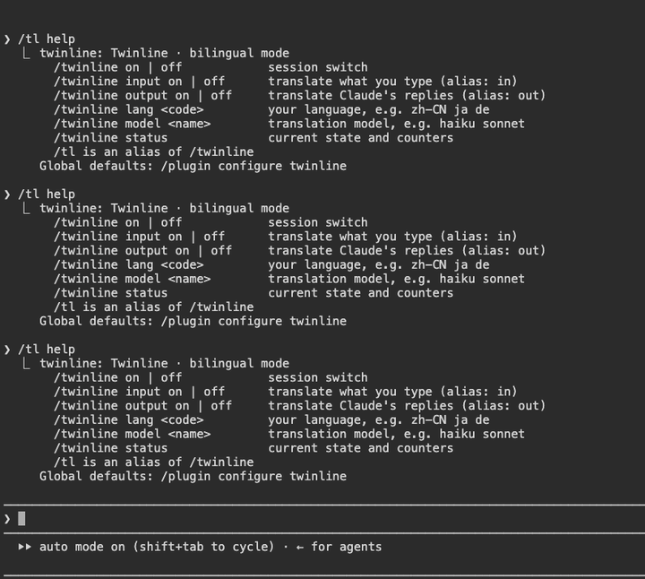
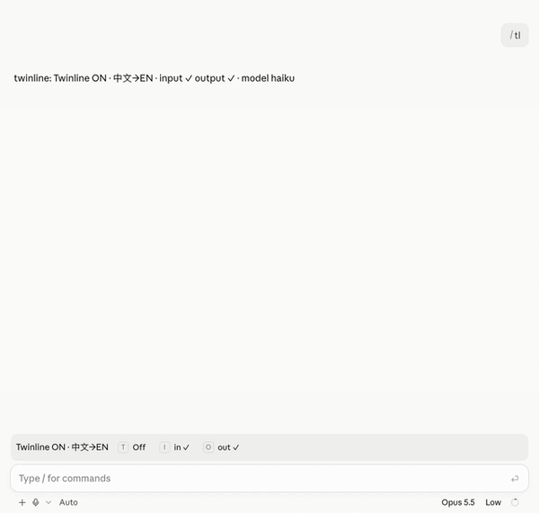

# Twinline

[English](README.md) · **简体中文**

Claude Code 的双语模式：用你的母语写，让 Claude 用英文工作，两种语言对照着读。



Twinline 是一个 Claude Code 插件（mod）。开启后，你输入的内容会先翻译成英文再发送，模型和对话记录里只有英文。你的每条消息显示原文，下方是英文；Claude 的每个回复块稳定后，下方出现译成你母语的译文。

Desktop 应用的 Code 标签页：



两段演示都包括：用中文写、看英文回复和下方译文；用 `/tl lang` 切换到繁体中文和日文；用状态条关掉、再打开输出翻译；关闭 Twinline 后已翻译的历史仍然保留。

## 安装

需要 **Claude Code 2.1.292 或更高版本**（CLI 与 Desktop 应用的 Code 标签页）。

在终端会话里输入：

```
/plugin install twinline --marketplace jacksonlin-infra/twinline
```

按 `y` 添加 marketplace，再选择作用域（选用户作用域则每个会话都会加载，包括 Desktop 应用的本地会话）。

每个新会话里 Twinline 默认**开启**，输入框上方的状态条可以一键关闭和开启（也可以用 `/twinline off`）。想让新会话默认关闭，把 `default_enabled` 设为 `false`。

安装界面可以设置全部选项。文本和数字项在那里显示为空，但每项的默认值写在名称和底部说明里；选 **Save configuration** 时空白项会自动使用默认值，所以不改任何项直接保存即可。以后在 `/plugin` → **Installed** → **twinline** → **Configure options** 修改。分步的安装、配置、语言、后端与故障排查说明见 **[使用指南](docs/GUIDE.zh-CN.md)**。

## 命令

| 命令 | 作用 |
|---|---|
| `/twinline` | 显示本会话的状态 |
| `/twinline on` / `off` | 在本会话开启或关闭 Twinline |
| `/twinline input on` / `off` | 翻译你输入的内容（简写 `in`） |
| `/twinline output on` / `off` | 翻译 Claude 的回复（简写 `out`） |
| `/twinline lang <code>` | 你的语言，如 `zh-CN`、`ja`、`de` |
| `/twinline model <name>` | 翻译用的模型，如 `haiku`、`sonnet` |
| `/twinline status` | 状态与计数：翻译次数、失败次数、缓存命中、存储大小 |
| `/twinline help` | 帮助 |

`/tl` 是 `/twinline` 的别名。开启时，输入框上方的状态条显示当前状态和 **Off**、**in**、**out** 三个按钮（终端里用 Ctrl+X Tab 聚焦状态条后按 `t`、`i`、`o`；Desktop 应用里直接点击）。

会话设置在 `/clear`、`/resume`、`/branch` 之后保留。关闭 Twinline 后，已翻译的消息仍保留译文。

## 语言

在选项里设一次 `language`，或在会话里用 `/tl lang <code>` 切换。任何语言都可以用；繁体中文（`zh-TW`、`zh-HK`）和日文（`ja`）的回复译文有专门的字形与文风规则。切换语言后，已有的译文保持原来的语言。详见[使用指南 §6](docs/GUIDE.zh-CN.md#6-语言)。

## 配置

全局默认值在插件选项里（会话中的 `/config`，或安装时的设置界面）。

| 选项 | 默认值 | 含义 |
|---|---|---|
| `default_enabled` | `true` | 每个新会话都默认开启 |
| `language` | `zh-CN` | 你读写所用语言的 BCP-47 代码。`zh-TW`/`zh-HK` 用繁體字与台灣/香港用語；`ja` 用です・ます体与片假名术语 |
| `translate_input` | `true` | 把你输入的内容翻译成英文 |
| `translate_output` | `true` | 在每个回复块下显示译文 |
| `model` | `haiku` | 翻译所用模型的别名或 id，经你现有的 Claude Code 登录调用 |
| `glossary` | — | 术语，写成 `原文=译文`，如 `工作区=workspace`（双向生效） |
| `always_translate_input` | `false` | 只含 ASCII 字母的输入也翻译（拉丁字母书写的语言需要） |
| `show_band_when_off` | `true` | 关闭时也保留输入框上方的状态条 |
| `input_timeout_ms` | `8000` | 输入翻译超过这么久就放弃，按原样发送 |
| `settle_ms` | `1200` | 回复块保持不变多久后才翻译 |
| `backend` | `claude` | 翻译在哪里完成：`claude`、`openai`、`deepl`、`ollama` |
| `backend_url` | — | `openai`/`ollama` 的基础 URL（如 `http://localhost:11434/v1`），或 DeepL 主机 |
| `backend_model` | — | `openai`/`ollama` 的模型名 |
| `backend_key` | — | 外部后端的 API key（保存在安全存储里） |

Twinline 依赖模型用英文回答。如果 Claude Code 自身的 `language` 设置让它改用你的语言回答，回复就不再是译文；开启 Twinline 时请不要设置该项。

## 在哪里生效

| 界面 | 你的消息 | 回复 | 状态条 |
|---|---|---|---|
| 终端（CLI） | 原文 + 灰色英文行 | 每个回复块下方带竖线的译文 | ✓ |
| Desktop 应用 Code 标签页 | 气泡里是原文 + 气泡下灰色英文行 | 每个回复块下方的译文框 | ✓ |
| VS Code 扩展、移动端 | 发送前翻译 | 不绘制 | — |

不翻译：斜杠命令、`!` 开头的 shell 命令、本来就是英文的输入（除非开启 `always_translate_input`）、代码块、行内代码、URL、`@` 引用、文件路径、`fetchUser`、`MAX_SIZE` 这类标识符，以及 `[Image #N]` 标记。

已知限制：

- Desktop 应用里，Claude 在两次工具调用之间写的文字不会交给插件，因此没有译文。
- Desktop 应用里，发送 `/twinline` 或 `/tl` 后输入框上方会提示 `/twinline isn't a command here.`：Desktop 不把插件运行时注册的命令当作自己的命令。命令照常执行（输出和状态条都会正常更新）。状态条上的按钮不需要命令就能切换。
- 只翻译进行中的回合里的回复。之后重新绘制的历史（`/resume`、重新打开 Desktop 会话、滚动）显示已保存的译文，但不会发起新的翻译。
- URL 后面不加空格直接跟标点时，标点可能被当成 URL 的一部分。

## 工作原理

```
你输入 ──▶ prompt.submit ──▶ 翻译成英文 ──▶ 模型只看到英文
                               │
                               └─ 原文保存在 Twinline 自己的存储里
对话记录 ──▶ ui.render UserMessage      ──▶ 你的原文 + "EN · …"
回复     ──▶ ui.render AssistantMessage ──▶ 引擎绘制的回复块 + 稳定后的译文
```

翻译经 Claude Code 的 mods API（`$.model.complete`，默认 `haiku`）用你现有的登录完成。代码、URL、路径和标识符在翻译前替换为占位符，翻译后必须每个恰好出现一次，否则放弃这次译文。任何失败都回到原文：输入来不及翻译就按原样发送，回复翻译失败就只显示原文。译文会跨会话缓存。

## 隐私

```
Twinline sends the text you type (minus protected code, paths and URLs) and
Claude's replies to a translation model. By default that model is Claude,
called through Claude Code's official mods API with your existing sign-in,
so nothing leaves the channel your session already uses.

If you configure an external backend (OpenAI-compatible, DeepL or Ollama),
that text is sent to the endpoint you configured, and only then.

Twinline stores your original messages and cached translations in
~/.claude/plugins/store/ on your machine. It collects no analytics and
makes no network requests other than translation.
```

即：你输入的文字（去掉受保护的代码、路径和 URL）和 Claude 的回复会交给翻译模型。默认就是 Claude，经 Claude Code 官方 mods API 用你现有的登录调用，不离开会话本来使用的通道。只有在你配置了外部后端（OpenAI 兼容、DeepL 或 Ollama）时，这些文字才会发到你配置的地址。原文与译文缓存只保存在你本机的 `~/.claude/plugins/store/`。不收集任何分析数据，除翻译外不发起网络请求。配置了外部后端时，每个会话开始都会提示译文发往何处。

## 开发

```
claude plugin validate --strict .   # 清单与模块扫描
claude plugin test .                 # 测试，terminal 与 desktop 两种界面
tsc -p .                             # 先用 `claude --plugin-dir .` 开一次会话生成类型
claude --plugin-dir .                # 从源码目录运行
```

Desktop 应用：在 `~/.claude/settings.json` 的 `env` 块里把源码目录的绝对路径写进 `CLAUDE_CODE_PLUGIN_DIRS`，然后新建 Code 会话。`npm run check` 依次运行上面三项检查。

## 文档

| 文档 | 用途 |
|---|---|
| [使用指南](docs/GUIDE.zh-CN.md) · [Guide](docs/GUIDE.md) | 安装、配置、语言、术语表、外部后端、更新、故障排查、常见问题 |
| [OpenRouter 后端](docs/OPENROUTER.zh-CN.md) · [OpenRouter backend](docs/OPENROUTER.md) | 通过 OpenRouter（或任何 OpenAI 兼容接口）用第三方模型翻译 |
| [更新日志](CHANGELOG.md) | 每个版本的变化 |
| [参与贡献](CONTRIBUTING.md)（英文） | 报告问题、提交修改、验证一个版本 |
| [安全](SECURITY.md)（英文） | 私下报告安全漏洞 |

## 许可证

[MIT](LICENSE) © 2026 Jacksonlin

Twinline 是独立项目，与 Anthropic 没有关联，也未获其背书。Claude 和 Claude Code 是 Anthropic, PBC 的商标。

## Star 趋势

<a href="https://www.star-history.com/#jacksonlin-infra/twinline&Date">
 <picture>
   <source media="(prefers-color-scheme: dark)" srcset="https://api.star-history.com/svg?repos=jacksonlin-infra/twinline&type=Date&theme=dark" />
   <source media="(prefers-color-scheme: light)" srcset="https://api.star-history.com/svg?repos=jacksonlin-infra/twinline&type=Date" />
   
 </picture>
</a>
